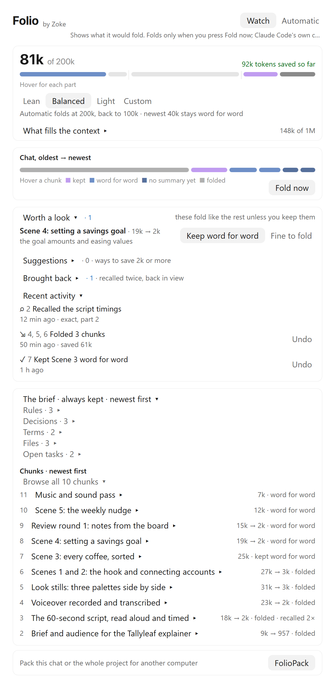
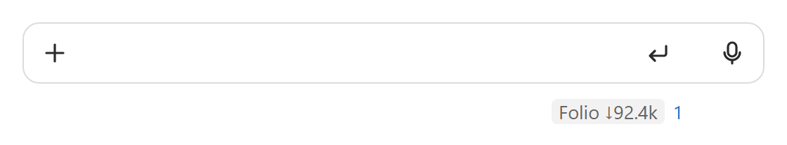

# Folio

**Folio — a quiet archive that keeps long chats light.**

A long chat fills Claude's context, and Claude Code's own compaction then squeezes all of it into one summary. Folio
splits the chat into chunks as it goes, has Haiku summarise the older ones, and folds them out of the context. Every
original stays on your computer word for word, and Claude can bring any of it back with Folio's recall tool.

<picture>
  <source media="(prefers-color-scheme: dark)" srcset="images/folio-panel-dark.png">
  
</picture>

<picture>
  <source media="(prefers-color-scheme: dark)" srcset="images/folio-footer-dark.png">
  
</picture>

## What it does

- **The ring and the panel.** "Folio" sits at the right of the prompt footer, with a ring for how close the next fold
  is and the tokens saved so far. Press it, or type `/folio`, to open the panel beside the chat.
- **Watch or Automatic.** In Watch, Folio shows what it would fold and you press **Fold now**. In Automatic it folds the
  oldest work by itself. Every fold can be undone: **Put back in the chat** for one chunk, **Undo all** for a fold.
- **How full a chat gets.** Light folds at 300k tokens, Balanced at 200k, Lean at 150k. Custom sets your own ceiling,
  from 350k, in chats whose context is big enough.
- **What fills the context.** The panel shows each part of the context, the work that counts toward the next fold,
  chunks worth a look before they fold (ones holding exact values), and what Folio did recently.
- **The brief.** The rules, decisions, terms, files and open tasks from every chunk, kept in the context, newest first.
- **Recall.** Claude calls `recall` to look up anything folded, trimmed or compacted. It answers with checked quotes,
  or the original words exactly, or a part of the folded history by its number ("32", "31–33", "32.B", "32.B2"). It
  works after Claude Code's own compaction too, and Folio reminds Claude of it after every compaction. Each answer
  ends with the parts that share its files or terms, and a question that names a file or a term lists every part that
  holds it.
- **Long shell outputs.** A shell command's output over 8,000 characters reaches Claude as its start, its end and a
  note. Folio saves the whole output first, and recall gives any of it back word for word: all of it, a stretch of
  lines, or the lines with some words. Files Claude reads, pages and skill notes always arrive whole, and Claude Code
  itself already moves outputs over about 30,000 characters into a file.
- **FolioPack.** Packs this chat or the whole project into one folder and zip: the summaries, the brief, the outline
  and the originals, plus any files you tick. Use it to carry the work to a new chat or another computer. A chat with
  Folio opens a pack with its `import_pack` tool; without Folio, the pack's `START-HERE.md` tells Claude how to read it.

## Install

In a terminal:

```
claude plugin install folio --marketplace Zoke-Hub/claude-tools
```

Or in a chat: `/plugin marketplace add Zoke-Hub/claude-tools`, then `/plugin install folio@zoke`.

Open a new chat afterwards. To update: `claude plugin update folio@zoke`, then restart the app.

## What it needs

- Claude Code in the Claude desktop app. Tested on Claude Code 2.1.308. The panel also draws in the terminal.
- Haiku writes the summaries, titles and the brief. Those calls go through Claude Code like any other request and count
  toward your own usage.

## Your data

- Everything stays on your computer. Each chat's index, summaries and originals are in
  `~/.claude/folio/sessions/<chat id>/` (on Windows, the same path under your user folder).
- Private items (keys, tokens, passwords, card and phone numbers, email addresses) are swapped for placeholders before
  anything is saved. The real values stay in that chat's private file, and only recall on the same computer reads them
  back. Summaries and packs hold the placeholders only.
- Long shell outputs Folio shortened are kept whole in that chat's `outputs/` folder, private items swapped out the same
  way.
- `~/.claude/folio/prefs.json` keeps where packs are saved. Packs go to `~/FolioPacks` unless you choose another folder.

## Settings

In the panel: Watch or Automatic, the strategy and Custom's ceiling are kept for each chat. FolioPack's **Saves to** is
kept for every chat.

One plugin setting, **Shorten long shell outputs** (`shortenOutputs`), is on by default. Turn it off in Claude Code's
plugin settings, or in `~/.claude/settings.json`:

```json
"pluginConfigs": { "folio@zoke": { "options": { "shortenOutputs": false } } }
```

## Uninstall

```
claude plugin uninstall folio@zoke
```

Your saved chats stay in `~/.claude/folio/`. Delete that folder too if you want them gone. Without Folio, folded
chunks stay as their summaries and recall stops working.

## Licence

Copyright 2026 Zoke. Free to use, paid work included, and to share unchanged; fixes only, no other changes. The "by Zoke" credit stays.
The full terms are in [LICENSE](LICENSE).

Folio · by Zoke
