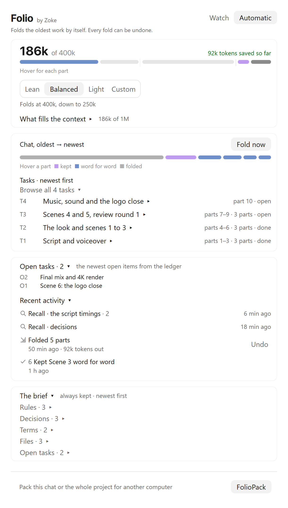
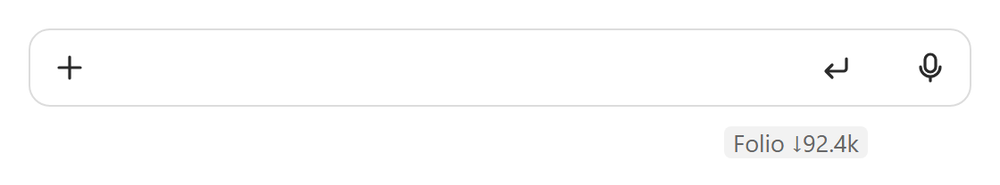

# Folio

**Folio — a quiet archive that keeps long chats light.**

A long chat fills Claude's context, and Claude Code's own compaction then squeezes all of it into one summary. Folio
splits the chat into parts as it goes, has Haiku summarise the older ones, and folds them out of the context. Every
original stays on your computer word for word, and Claude can bring any of it back with Folio's recall tool.

<picture>
  <source media="(prefers-color-scheme: dark)" srcset="images/folio-panel-dark.png">
  
</picture>

<picture>
  <source media="(prefers-color-scheme: dark)" srcset="images/folio-footer-dark.png">
  
</picture>

## What it does

- **The footer and the panel.** "Folio" sits at the right of the prompt footer, with the tokens saved so far. Press it,
  or type `/folio`, to open the panel beside the chat. Its meter shows how full the chat is, in red once it is past
  the point where a fold starts.
- **Watch or Automatic.** In Watch, Folio shows what it would fold and you press **Fold now**. In Automatic it folds the
  oldest work by itself. Every fold can be undone: **Restore** for one part, **Undo all** for a fold.
- **How full a chat gets.** Sizes are real tokens of the whole context, as Claude's requests count them. Light folds
  at 550k, down to 350k; Balanced at 400k, down to 250k; Lean at 300k, down to 180k. Custom sets where a fold starts,
  from 350k to 800k, in chats whose context is big enough, and it stops at 62.5% of that. The newest work (the open turn and about 80k
  before it) always stays word for word. In Automatic a fold at the ceiling waits until it frees at least a third of
  what it keeps, and never comes within 30 requests of the last one. After an hour or more idle, when the prompt
  cache has gone, Automatic folds to the floor before the next request.
- **Stripped, then folded.** A fold first strips the oldest parts: your words and Claude's stay exactly as they were,
  and each big tool input (a script written, a long command, a long edit) and each big output becomes a one-line note
  that names the part to recall. Short commands and small edits stay whole. A stripped part folds at a later fold.
  A part you keep is never stripped or folded, and **Fold now** may fold a part at once. A whole turn of side talk
  (chatter, or talk about other chats) folds first and leaves no line in the history.
- **Claude Code's own compaction.** In Automatic, Folio answers it with a fold, in the middle of a long reply too: the
  older parts fold and the reply goes on. If you lower Claude Code's compaction window
  (`CLAUDE_CODE_AUTO_COMPACT_WINDOW`), Folio hands the chat back unchanged while it is still under the model's own
  compaction point, in Watch always and in Automatic when nothing can fold, so the chat goes on as if the window were
  not lowered. Past that point Claude Code compacts as before. Claude Code stops a reply when its compaction comes
  within three requests of the one before, three times in a row, so where handing the chat back would make the third,
  Folio skips that compaction (a "not compacted" line shows) and goes on after a few requests.
- **What fills the context.** The panel shows each part of the context, the work that counts toward the next fold,
  the newest open tasks, and what Folio did recently, each recall as one line.
- **Tasks.** Every part belongs to a task. The panel lists the tasks, newest first; a task opens to its parts, and a
  part to its card, where you can keep it word for word.
- **The brief.** The rules, decisions, terms, files and open tasks from every part, kept in the context, newest first.
- **Recall.** Claude calls `recall` to look up anything folded, stripped or compacted. With no model, at once, it
  returns the best passages word for word (whole messages), only one kind of content when asked (the commands that
  were run, your own messages, Claude's replies, outputs, files), a part's card by its number ("32", "31-33", "32.B")
  or a task's ("T9"), or the brief's decisions, values and tasks with their status. Asked to, Haiku answers from the
  passages, with checked quotes. Several asks can go in one call, and a passage Claude already has in view is not
  given twice. It works after Claude Code's own compaction too, and in subagents: each brief Claude writes gets a line
  about recall. Each answer ends with the parts that share its files or terms. Another chat's history stays in that
  chat: Claude asks it there with a message.
- **Pointers.** When your prompt names a file, an id such as A29, or a task that only folded parts hold, Claude gets
  one line saying which parts mention it ("Folded parts that mention A29: 77, 79, 96."), with no model call.
- **Long shell outputs.** A shell command's output over 20,000 characters reaches Claude as its start, its end and a
  note. Folio saves the whole output first, and recall gives any of it back word for word: all of it, a stretch of
  lines, or the lines with some words. Files Claude reads, pages and skill notes always arrive whole, and so does a
  shell command that only prints files (`cat`, `sed -n`, `grep` over named files) and every output inside a subagent.
  Claude Code itself already moves outputs over about 30,000 characters into a file.
- **FolioPack.** Packs this chat or the whole project into one folder and zip: the summaries, the brief, the outline
  and the originals, plus any files you tick. Use it to carry the work to a new chat or another computer. A chat with
  Folio opens a pack with its `import_pack` tool; without Folio, the pack's `START-HERE.md` tells Claude how to read it.
  The files you tick are listed by the project's own folders: a section for each folder at its top, its folders as
  rows, and the `Renders` folder as it is kept (Drafts, then Final, each animation's renders by round). A file never
  leaves its folder. Haiku only splits the files that sit together in one folder by kind (stills apart from boards, say);
  with no answer from it, each folder is one row. A pack carries each part's card, the tasks and the
  ledger. Its parts take the next numbers of the chat that opens it, so recall reaches them by number. With **Saves
  to** left empty, a pack goes to the project's `Work/Folio/Folio packs` folder (made when needed), or to `~/FolioPacks`
  for a chat with no project folder or in a code repository; earlier packs in that folder are never packed again.
- **Project folders.** Folio gives every chat a short rule for laying out a project's folders: `Animations`,
  `Renders/Drafts` and `Renders/Final` by animation, `Segments` by animation, sorted `References`, and `Work` for
  everything else (`Work/Scripts` for the script and breakdown, `Work/Backup`, and a folder for each tool), with a README
  at the top and folder names starting with a capital letter. A project's own layout rule comes first, and a code
  repository keeps its own. Claude offers to tidy a project that has drifted and moves files only on your yes.
  FolioPack's groups follow the same layout.
- **Where new files go.** As a chat starts, Folio reads where the project already keeps each kind of file (renders,
  editing and design projects, references, sound) and tells Claude in a short note (about 150 tokens). The
  project-folders rule comes first: the note fills in where a project doesn't follow that layout yet, or where the rule
  names no place, and Claude moves files only as the rule says, on your yes. With the rule turned off, the note tells
  Claude to save new files of each kind where they already live and never to move one. Folders that differ in one name
  only read as one place: `segments/A16/renders` and `segments/A19/renders` become `segments/<animation>/renders`, and
  renders numbered `r01_…` keep being numbered. A skill's own place still wins. Auto-save, backup and scratch folders
  don't count. In a folder of several projects, a place counts as `<project>/…` only when every project keeps that kind
  there. Folio itself never moves, renames or tidies a file; a project with no clear layout, one too big to read whole,
  and the home folder get no note. The note is saved per folder, so a chat that starts before its read is done uses the
  last one.
- **A copy in the project.** In a project with a `Work` folder at its top, Folio keeps a copy of each chat's files there
  as it writes its own: the summaries in `Work/Folio/<chat id>/`, and the originals, shortened outputs and log in
  `Work/Backup/Folio/<chat id>/`. It still reads only its own store, so recall keeps working if the project moves.

## Install

In a terminal:

```
claude plugin install folio --marketplace Zoke-Hub/claude-tools
```

Or in a chat: `/plugin marketplace add Zoke-Hub/claude-tools`, then `/plugin install folio@zoke`.

Open a new chat afterwards. To update: `claude plugin update folio@zoke`, then restart the app.

## What it needs

- Claude Code in the Claude desktop app. Tested on Claude Code 2.1.308. The panel also draws in the terminal.
- Haiku writes the summaries, titles and the brief, and sorts FolioPack's files. Those calls go through Claude Code like
  any other request and count toward your own usage. Sorting a big project's files the first time takes a few calls:
  about one for every 1,000 files, at most 12.

## Your data

- Everything stays on your computer. Each chat's index, summaries and originals are in
  `~/.claude/folio/sessions/<chat id>/` (on Windows, the same path under your user folder). In a project with a `Work`
  folder at its top, a copy of the same files goes in `Work/Folio/<chat id>/` and `Work/Backup/Folio/<chat id>/`; the
  private file is never copied.
- Private items (keys, tokens, passwords, card and phone numbers, email addresses) are swapped for placeholders before
  anything is saved. The real values stay in that chat's private file, and only recall on the same computer reads them
  back. Summaries and packs hold the placeholders only.
- Long shell outputs Folio shortened are kept whole in that chat's `outputs/` folder, private items swapped out the same
  way.
- A log of what Folio did, sizes and times only (never the chat's words), is in
  `~/.claude/folio/log/<date>/<chat id>.jsonl`: each Haiku call, fold, wait, recall and shortened output, one line each.
- `~/.claude/folio/prefs.json` keeps where packs are saved. With it empty, packs go to the project's
  `Work/Folio/Folio packs`, or to `~/FolioPacks` for a chat with no project folder.
- To split a folder's files by kind, Haiku reads each file's name, size and kind, and the first 240 characters of up to 300 small
  text files. Folio never sends the start of its own private file, or of files named like keys, passwords, tokens or
  secrets. Before it cuts a file's start, Folio runs its private-value finder over the whole file (keys, tokens,
  passwords, card and phone numbers, email addresses, and any value the chat already set apart) and swaps what it finds
  for placeholders, so a value the cut would split is never sent. Names in the listing get the same check. Its answer
  is kept in `~/.claude/folio/categories/`, one file per project, and asked for again only where files changed.
- Each folder's last note on where its project keeps its files is in `~/.claude/folio/layouts/`.
- A saved file Folio can't read as it wrote it is kept, as it was, in a `damaged-<time>/` folder in that chat's folder,
  and the log says so. A chat whose files can't be read at all, or that a newer Folio saved, is left alone: Folio says
  so once and changes none of its files.

## Settings

In the panel: Watch or Automatic, the strategy and Custom's ceiling are kept for each chat. FolioPack's **Saves to** is
kept for every chat.

Plugin settings:

- **Shorten long shell outputs** (`shortenOutputs`), on by default.
- **Point Claude to folded parts** (`promptPointers`), on by default: the one line added to a prompt or a subagent's
  brief that names something only folded parts hold.
- **Keep project folders organised** (`projectLayout`), on by default: the project-folders rule, about 400 tokens, sent
  at the start of a chat and after each compaction.
- **Tell Claude where this project keeps its files** (`projectPlaces`), on by default: the note a chat's first
  message carries, after the project-folders rule (see "Where new files go").
- **Keep a copy of each chat in its project** (`projectCopies`), on by default: the copy in `Work/Folio` and
  `Work/Backup/Folio`. Turned off, no new copies are written; the ones written stay.
- **Ask Claude for a note before a fold** (`foldNote`), off by default until it has been tried in the app. Before
  Automatic folds while the prompt cache is warm, Folio asks Claude itself what is still open, what it is in the middle
  of, and what in the parts about to fold it needs word for word. The answer closes finished open tasks, writes the
  map's State now, and can hold a part back from that fold. It costs about one ordinary request a fold, and a fold waits
  at most 30 seconds for it. Never on a cold fold or Claude Code's own compaction.
- **Where the list of tasks sits** (`tasksPlace`): under the chat strip (the default), or in a box of their own.
- **Where FolioPack sits** (`footerPlace`): pinned at the bottom of the panel under a thin rule (the default), or right
  after the last box.

Change them in Claude Code's plugin settings, or in `~/.claude/settings.json`:

```json
"pluginConfigs": { "folio@zoke": { "options": { "shortenOutputs": false, "projectCopies": false, "foldNote": true } } }
```

## Uninstall

```
claude plugin uninstall folio@zoke
```

Your saved chats stay in `~/.claude/folio/`. Delete that folder too if you want them gone. Without Folio, folded
parts stay as their summaries and recall stops working.

## Licence

Copyright 2026 Zoke. Free to use, paid work included, and to share unchanged; fixes only, no other changes. The "by Zoke" credit stays.
The full terms are in [LICENSE](LICENSE).

Folio · by Zoke
