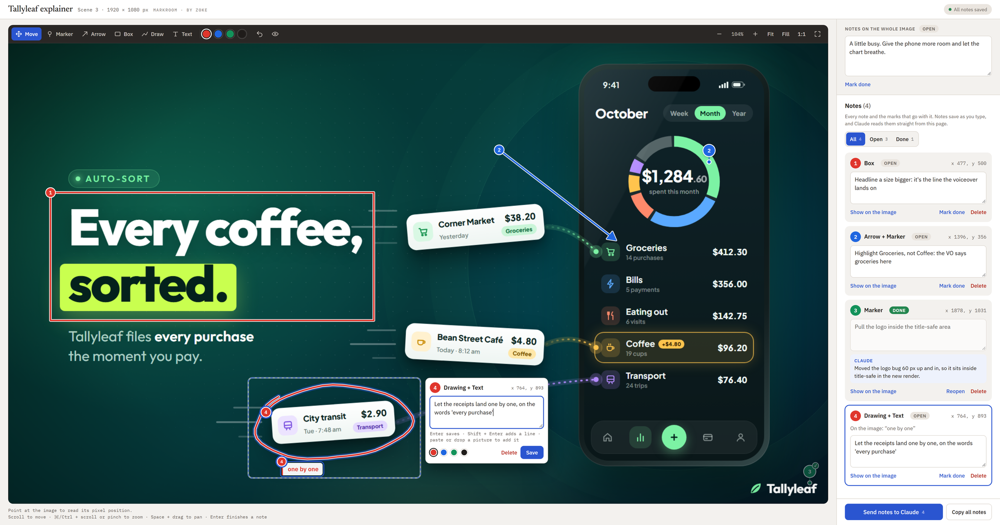

# MarkRoom

MarkRoom — your review room: mark it, note it, and Claude changes it.

MarkRoom is a review board for still images and videos that Claude builds as a private claude.ai artifact. You draw
markers, arrows, boxes, freehand lines and text on a picture or a paused video frame, gather the marks for one point
into a numbered note and write what should change. Notes save as you type. Claude reads them from the board, draws each
note onto its image or frame to see exactly what you pointed at, makes the changes, then replies to and closes each
note on the same page. New rounds of the same file land in the same tab, with older rounds a click away, and video
notes are pinned to a timecode or a range.

<picture>
  <source media="(prefers-color-scheme: dark)" srcset="images/markroom-board-dark.png">
  
</picture>

## Install

In a terminal:

```bash
claude plugin install markroom --marketplace Zoke-Hub/claude-tools
```

Or in a Claude Code chat:

```
/plugin marketplace add Zoke-Hub/claude-tools
/plugin install markroom@zoke
```

Then ask Claude for a review board, for example "make a MarkRoom board for these three frames".

**Update:** `claude plugin update markroom@zoke`, then restart Claude Code.

## What it needs

- **Claude Code**, tested with 2.1.309 in the desktop app.
- **A claude.ai account whose artifacts can use a database, comments, file uploads and the viewer's profile** (Claude
  uses them through its ArtifactData and ArtifactComments tools). Without the database a board can't save notes; it
  then offers to copy them as text instead.
- **Node.js** 18 or later, to build boards (no npm packages).
- **Python 3.10 or later with Pillow**, to draw the notes onto the images: `python3 -m pip install Pillow`.
  macOS's own `python3` is older and has no Pillow; use one from python.org or Homebrew.
- **ffmpeg**, for video tabs (and for converting unusual image formats where macOS's `sips` isn't there). If
  Homebrew's `ffmpeg-full` is installed, it's used first.

## Where things are kept, and what is sent

- Each board is a folder in your project (`review/<name>-markroom`: the page, the prepared images and `board.json`),
  plus the artifact on claude.ai, which is private until you share it.
- Notes, replies, closed tabs and tab order live in that artifact's database on claude.ai; pictures pasted into notes
  and live rounds go to its file store. What Claude reads back is saved under the board folder (`feedback/`,
  `feedback-render/`).
- Your browser keeps a few conveniences (which round you last saw, an unsaved draft) in its local storage.
- **Send notes to Claude** posts one comment on the artifact for the Claude chat watching the board. The page loads
  its fonts from Google Fonts. Nothing else leaves your computer or claude.ai.

## Settings

None.

## Uninstall

```bash
claude plugin uninstall markroom@zoke
```

Boards you made stay in your claude.ai artifacts and project folders.

## Licence

Free to use, paid work included, and to share unchanged; no changes except fixes, and the copyright line and the "by Zoke" credit stay.
Full terms in [LICENSE](LICENSE).

MarkRoom · by Zoke
