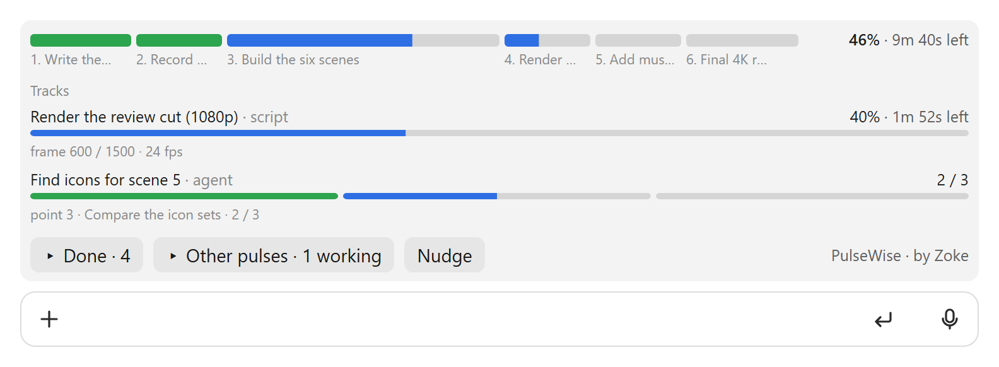

# PulseWise

PulseWise — a live bar for everything Claude is doing.

PulseWise draws a progress bar under the chat's task list. Each point of the list is one beat of the bar, as wide as
the time it takes. Every background agent, command or counted script gets its own track. Other chats open in the same
project show their own bars behind an "Other pulses" button, and clicking one takes you to that chat. The bars fill
from real work (the task list, Claude's tool calls, background jobs and scripts' own counts), not from Claude
remembering to update anything. It spends no Claude tokens while it runs.

<picture>
  <source media="(prefers-color-scheme: dark)" srcset="images/pulsewise-dark.png">
  
</picture>

## Install

From a terminal:

```bash
claude plugin install pulsewise --marketplace Zoke-Hub/claude-tools
```

Or in a chat: `/plugin marketplace add Zoke-Hub/claude-tools`, then `/plugin install pulsewise@zoke`.

To update, run `claude plugin update pulsewise@zoke` and restart the app.

## What it needs

- Claude Code 2.1.308 in the desktop app (Code tab), the version it was tested on. The band under the task list is
  the desktop app's own panel. In the terminal, PulseWise shows a one-line status instead. Phone and web clients of a
  Remote Control chat show neither.
- Python 3.9 or later (`python3`, or `python` on Windows) for the helper scripts use to report their counts. It uses
  only Python's standard library.

## The parts

| Name | What it is |
|---|---|
| pulse | a chat's main bar |
| beat | one segment of the pulse: one point of the task list. Click it to open its close-up |
| readout | the line above the pulse while a beat is open: its name, status and %, with a × to close it |
| track | a background job's bar, under "Tracks" |
| sweep | the light block moving through a bar: work going on that has no count to measure |
| Other pulses, Done, Nudge | the buttons under the band. Nudge asks Claude to bring the task list up to date |

## What it tells Claude

- **Long jobs (always on).** Once per conversation, and again after every compaction, PulseWise gives Claude a short
  instruction (about 300 tokens): any script or command expected to run longer than about half a minute reports its
  counts through the helper, so it gets a track that shows real progress and time left. The same instruction asks
  Claude to keep the task list current, one point at a time.
- **Nudge.** When you press Nudge, Claude gets a one-line reminder (about 30 tokens) at its next step.
- **Side-by-side planning (on unless you turn it off).** When Claude writes a new task list, PulseWise asks it to start the points that need nothing from each other at the same time, as background agents or commands, without being asked. See Settings to turn it off.

## The helper

The plugin carries its helper, `progress.py`. When PulseWise starts, it copies the helper to
`~/.claude/progress/progress.py` if it is missing there or older, so scripts and agent briefs have one fixed path to
call:

```bash
python3 ~/.claude/progress/progress.py run --name "Render" -- ffmpeg -i in.mov out.mp4
```

`run` passes the command's output through unchanged and reads its progress from that output: ffmpeg's `time=`, `NN%`
or `done/total` lines. A Python script can `import progress` from that folder and use `progress.job`,
`progress.step` and `progress.track`. To try it, run `python3 ~/.claude/progress/demo.py`, a 20-second demo.

## Where it keeps data

Everything stays in `~/.claude/progress/` on your computer. PulseWise sends nothing anywhere.

- `jobs/`: one small status file per job. Finished ones are removed after a day.
- `chats/`: each chat's progress, which other chats in the same project read for "Other pulses". A file nobody has
  touched for two days is removed. `chats/.seen.json` remembers which finished chats you have already seen.
- `history.json`: how long each step of a job took, used to size the job's next run.

PulseWise also reads the desktop app's own record of each chat (its title, and when you last opened it).

## Settings

| Setting | Default | What it does |
|---|---|---|
| `sideBySide` (Plan side-by-side work) | on | When Claude writes a new task list, PulseWise asks it to start the points that need nothing from each other side by side, as background agents or commands, without being asked (about 90 tokens per new list, and about 60 when points are added). The note lets a big but mechanical point go to an agent on a cheaper model, but only under the rules in `progress/cheaper-agents.md`. Turn it off if you'd rather Claude work through a list one point at a time. |

To change it, run `claude plugin configure pulsewise` in a terminal, or open `/config` in an interactive `claude`
terminal. You can also set it in `~/.claude/settings.json`:

```json
"pluginConfigs": { "pulsewise@zoke": { "options": { "sideBySide": false } } }
```

Settings take effect when the plugin next loads, after a restart or a new chat.

## Uninstall

```bash
claude plugin uninstall pulsewise@zoke
```

Then delete `~/.claude/progress/` if you don't want its job history.

## Licence

Free to use, paid work included, and to share unchanged. Fixes only, with no other changes. See [LICENSE](LICENSE).
PulseWise · by Zoke · Copyright 2026 Zoke.
