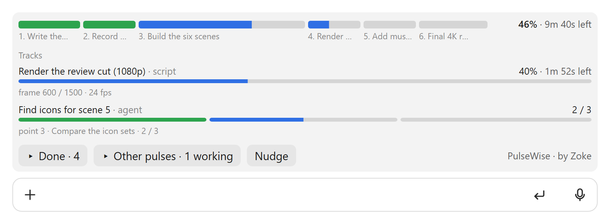

# PulseWise

PulseWise — a live bar for everything Claude is doing.

PulseWise draws a progress bar under the chat's task list. Each point of the list is one beat of the bar, as wide as
the time it takes. Every background agent, command or counted script gets its own track. The other chats open on this
computer (local ones, from any project) show their own bars behind an "Other pulses" button, and clicking one takes you to that chat. The bars fill
from real work (the task list, Claude's tool calls, background jobs and scripts' own counts), not from Claude
remembering to update anything. It spends no Claude tokens while it runs.

<picture>
  <source media="(prefers-color-scheme: dark)" srcset="images/pulsewise-dark.png">
  
</picture>

## Install

From a terminal:

```bash
claude plugin install pulsewise --marketplace Zoke-Hub/claude-tools
```

Or in a chat: `/plugin marketplace add Zoke-Hub/claude-tools`, then `/plugin install pulsewise@zoke`.

To update, run `claude plugin update pulsewise@zoke` and restart the app.

## What it needs

- Claude Code 2.1.308 in the desktop app (Code tab), the version it was tested on. The band under the task list is
  the desktop app's own panel. In the terminal, PulseWise shows a one-line status instead. Phone and web clients of a
  Remote Control chat show neither.
- Python 3.9 or later (`python3`, or `python` on Windows) for the helper scripts use to report their counts. It uses
  only Python's standard library.

## The parts

| Name | What it is |
|---|---|
| pulse | a chat's main bar |
| beat | one segment of the pulse: one point of the task list. Click it to open its close-up |
| readout | the line above the pulse while a beat is open: its name, status and %, with a × to close it |
| heading | the request the task list is for, in a few words, over the pulse while no beat is open |
| sub-tasks | a point's parts, in its opened beat's close-up: its bar, a list with their counts, or their names |
| track | a background job's bar, under "Tracks" |
| sweep | the light block moving through a bar: work going on that has no count to measure |
| Other pulses, Done, Nudge | the buttons under the band. Nudge asks Claude to bring the task list and its counts up to date |

## How a beat fills

A beat fills from what it is told, never from a guess:

- **Claude's own work** fills by Claude's count: when a point starts, Claude sizes it by its pieces (files to change,
  cases to run) and sends the count through PulseWise's `count` tool as the pieces finish, in the same message as its
  other calls. The close-up shows it as "Claude · 2 / 5 edits". If more pieces turn up, the total grows and the fill
  steps back a little: it stays honest. A point Claude can't size shows as moving, with no fill.
- **Sub-tasks.** A point with parts of its own (footage rows FF6 to FF9, two notes) gets them as sub-tasks, each with
  its own count, and the point's count is theirs. They show in the beat's close-up, when you open it: as its bar, one
  segment per sub-task, when they are counted in one unit with a few pieces each and the point takes 2 minutes or more
  ("FF8 · 1 / 4 clips"); as a list with their counts when they are short ("Note 2: photo entrance 1 / 2 changes"),
  done ones bright; by name only when they can't be counted. Either way they take the place of Claude's own part.
- **Background jobs** fill by the counts their scripts report through the helper. A command and the job it starts
  show as one bar, and a job that names its point (`--point 3`) joins that point. A step's time is measured from the
  start: steps reported late or skipped over share the time since the last report, and a step's numbers count the
  items inside it ("Tests · 14 / 16 tests"), never the step's own place in the list.
- **Background agents** get PulseWise's progress lines in their brief, added by PulseWise itself: their job carries
  the agent's own name and its point's number, so it lands on its own beat. An agent that only looks things up
  (Explore, Plan) is left alone. A job with no point goes to the agent that started it, else to the best-named one.
  An agent running a different model from the chat shows it as a tag ("· Fable"), and a beat whose one agent is named
  like it says "Agent (Fable)" once instead of repeating the name.
- **Servers and watchers** (a preview server, a file watcher) are not progress: they show under Tracks as "serving"
  and never hold the bar open.
- A point whose jobs are done but whose own work has no count stops just short of full until it is ticked.
- A job that stops reporting shows "no report" after its time (30 minutes unless it says otherwise) and waits, since
  it may report again. One whose command or agent was stopped ends with it, and one with no report for 2 hours leaves
  the bar as stopped (a power cut, say); it comes back if it reports after all.
- Changes to the task list (points added, taken off, renamed) show at once; a point renamed in place keeps its time
  and its count.
- A name longer than 32 characters gets a short label for the bar, written by a small model (Haiku), once per name.
  The long names of one list go together in one call, so their labels read apart; each keeps its name's first word,
  and none cuts a word short. It is the only thing PulseWise asks a model for, and Haiku is the model it uses for
  anything like it.
- A hover box shows a beat's or a button's full text only while the pointer is on it, inside the band.

## What it tells Claude

- **The standing instruction (always on).** Once per conversation, and again after every compaction, PulseWise gives
  Claude a short instruction (about 800 tokens): keep the task list current, one point at a time, a point being work
  ticked on its own; go over a new list for work done twice and say what it merged; count every point from its start
  with the `count` tool, with sub-tasks for its parts; send a new list's heading and estimate with the `estimate` tool;
  report any script or command expected to run longer than about half a minute through the helper, naming its point;
  name things in 32 characters or fewer, the telling words first.
- **Agents' briefs.** Each background agent that does work gets about 200 tokens of progress lines added to its brief:
  its job's name, its point's number, how to name and count its steps, and the list's other open points, which it
  leaves alone. A follow-up message to that agent gets the lines again, with its point's number as the list stands then.
- **Count reminders.** A point that starts without a count is asked for one at once (about 60 tokens): when its name
  already holds one ("FF6–FF9", "2 notes"), that count. A count gone 8 of Claude's calls without a change, or a
  background command still running 20 calls on with none, gets a one-line note at Claude's next step, at most once per
  8 calls a point (40 a command). For background work Claude can answer that it keeps running (a server) or is done.
- **Work done twice.** A sub-task, or a step of a job or agent, that names another open point's kind of work ("Check
  render" in point 2 beside a point 3 "Check r02 frame by frame") is told to Claude in one line, once; so is a job
  that names a point number the list doesn't have. A sub-task that can't be counted beside ones that can is told to be
  a point of its own.
- **Headings and estimates.** When Claude writes a new task list, it is asked for its heading (about 40 tokens); a list
  of more than three points, or one with background work running, is also asked (about 60 tokens) for its estimate:
  minutes of clock time for the whole list and for each point, decimals allowed. See "The time log".
- **Nudge.** When you press Nudge, Claude gets a one-line reminder (about 60 tokens) at its next step: the list, the
  counts and any background work that is done or keeps running.
- **Side-by-side planning (on unless you turn it off).** When Claude writes a new task list, PulseWise asks it to start the points that need nothing from each other at the same time, as background agents or commands, without being asked. See Settings to turn it off.

## The time log

Each task list that ran is written, once finished (or when a new list replaces it), as one line of
`~/.claude/progress/eta-log.jsonl`: Claude's estimate beside the real time, for the list and for each point, with the
time spent waiting for your replies left out, the point's count, which computer and which model. Once three lists
are on record, PulseWise corrects each new estimate itself by how past ones turned out (the median of real time over
estimated) and logs the corrected time beside it. The bar sizes each point not yet done by that point's estimate,
corrected (as sent until there are enough on record), so the points ahead show the work they hold; a running point
grows past its estimate once it takes longer. A point with no estimate takes the chat's typical point length. The bar
shows no time left.

To bring in the log from another computer, append its lines to this file: each line names its computer.

## The helper

The plugin carries its helper, `progress.py`. When PulseWise starts, it copies the helper to
`~/.claude/progress/progress.py` if it is missing there or older, so scripts and agent briefs have one fixed path to
call:

```bash
python3 ~/.claude/progress/progress.py run --name "Render" -- ffmpeg -i in.mov out.mp4
```

`run` passes the command's output through unchanged and reads its progress from that output: ffmpeg's `time=`, `NN%`
or `done/total` lines. A Python script can `import progress` from that folder and use `progress.job`,
`progress.step` and `progress.track`. To try it, run `python3 ~/.claude/progress/demo.py`, a 20-second demo.

## Where it keeps data

Everything stays in `~/.claude/progress/` on your computer. The one thing PulseWise sends anywhere is a name longer
than 32 characters, to Haiku through Claude Code's own connection, for its short label on the bar.

- `jobs/`: one small status file per job. Finished ones are removed after a day.
- `chats/`: each chat's progress, which the other local chats read for "Other pulses". A file nobody has
  touched for two days is removed. `chats/.seen.json` remembers which finished chats you have already seen.
- `history.json`: how long each step of a job took, used to size the job's next run.
- `eta-log.jsonl`: each task list's estimates beside its real times (see "The time log").

PulseWise also reads the desktop app's own record of each local chat (its title, when you last opened it, and whether
it is archived). A finished chat leaves "Other pulses" once you open it, or if you were on it when it finished.

## Settings

| Setting | Default | What it does |
|---|---|---|
| `sideBySide` (Plan side-by-side work) | on | When Claude writes a new task list, PulseWise asks it to start the points that need nothing from each other side by side, as background agents or commands, without being asked (about 90 tokens per new list, and about 60 when points are added). The note lets a big but mechanical point go to an agent on a cheaper model, but only under the rules in `progress/cheaper-agents.md`. Turn it off if you'd rather Claude work through a list one point at a time. |

To change it, run `claude plugin configure pulsewise` in a terminal, or open `/config` in an interactive `claude`
terminal. You can also set it in `~/.claude/settings.json`:

```json
"pluginConfigs": { "pulsewise@zoke": { "options": { "sideBySide": false } } }
```

Settings take effect when the plugin next loads, after a restart or a new chat.

## Uninstall

```bash
claude plugin uninstall pulsewise@zoke
```

Then delete `~/.claude/progress/` if you don't want its job history.

## Licence

Free to use, paid work included, and to share unchanged. Fixes only, with no other changes. See [LICENSE](LICENSE).
PulseWise · by Zoke · Copyright 2026 Zoke.
